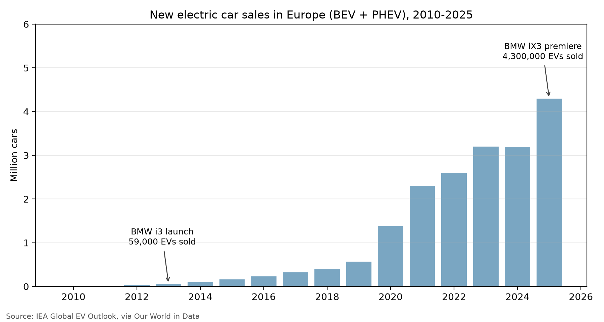
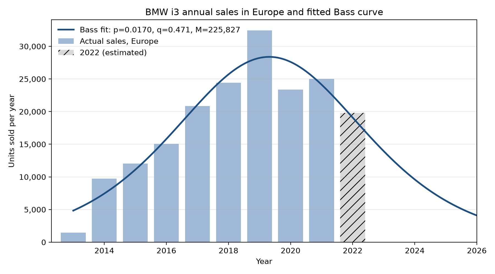
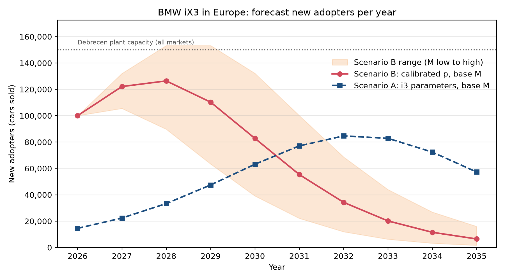
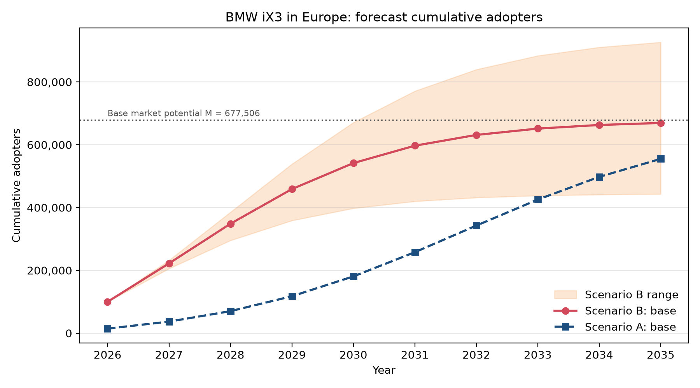

# Innovation Diffusion Analysis: BMW iX3 (Neue Klasse)

**DS 223 Marketing Analytics, Homework 1: Bass Model**

## 1. Selected innovation

**BMW iX3, "Next-gen electric SUV"**, category *Transportation*, TIME Best Inventions of 2025.
Link: <https://time.com/collections/best-inventions-2025/7318539/bmw-ix3/>

The iX3 is the first production model of BMW's "Neue Klasse", a vehicle architecture developed only for battery-electric cars. BMW invested more than \$11 billion in the platform. The iX3 offers about 400 miles (more than 800 km WLTP) of range and adds 175 miles in 10 minutes of charging (peak 400 kW) [1, 2]. It premiered at IAA Mobility in Munich on 5 September 2025. Series production started in October 2025 at the new BMW plant in Debrecen, Hungary, and the pan-European market launch took place on 7 March 2026 at a starting price of €68,900 [2, 3].

## 2. Look-alike innovation from the past: BMW i3 (2013)

The closest historical analogue is the **BMW i3**. It was BMW's first large-series fully electric car, launched in November 2013 and produced in Leipzig until June/July 2022 [5, 6]. Both cars mark a technological break for the same company. The i3 was built on the purpose-built *LifeDrive* architecture, with an aluminium drive module and a carbon-fibre passenger cell. The iX3 is built on the purpose-built *Neue Klasse* architecture, with BMW's own Gen6 high-voltage battery and a new "digital nervous system" of four central computers that receive over-the-air updates [1, 6]. In both cases BMW did not convert an existing combustion model. It built a new electric-only platform and positioned the car as the symbol of the brand's transformation. Even the name repeats: at the 2025 premiere BMW presented the iX3 together with the upcoming electric i3 sedan [2]. Because the seller, the distribution network, the price tier (premium) and the target customer (European premium buyers) are the same, the i3 adoption curve is a much better analogue than generic EV-market data. Category data would mix the iX3 with very cheap Chinese EVs and plug-in hybrids.

The market impact of the two cars also points in the same direction. The i3 ranked third among all-electric cars sold worldwide in 2014-2016, and in its early years more than 80% of its buyers were new to the BMW Group [5, 6]. Early demand for the iX3 has also been strong. Every third BEV that BMW customers in Europe ordered after the premiere was an iX3, and BMW raised the price by €2,000 before the launch because of demand [3, 7]. The main differences are segment and market maturity. The i3 was a small city car with 130-160 km of range (NEDC) [5], launched when Europe bought only about 59,000 electric cars per year. The iX3 is a mid-size SUV, the most popular body type in Europe (almost 54% of 2024 registrations [8]), launched into a market of 4.3 million electric cars per year [9]. I keep this difference in mind in Section 5: the *shape* of imitation (q) should carry over from the i3, but the *speed of the launch* (p) should be higher for the iX3.

## 3. Historical data

The table below shows annual BMW i3 sales (both the BEV and the range-extender versions). The data file is `data/bmw_i3_sales.csv`, and the source for every row is listed in that file.

| Year | Global units | Europe units | Source (global / Europe) |
|---|---:|---:|---|
| 2013 | 1,477 | 1,477 | Best Selling Cars Blog [10] |
| 2014 | 16,052 | 9,744 | BMW press release [11] / Nissan Europe & JATO [12] |
| 2015 | 24,057 | 12,047 | BMW press release [13] / JATO [12] |
| 2016 | ~25,500 | 15,060 | HybridCars [14] / EV Sales [15] |
| 2017 | 31,482 | 20,855 | BMW press release [16] / EV Sales [15] |
| 2018 | 34,623 | 24,432 | BMW Annual Report 2019 [17] / EV Sales [15] |
| 2019 | 39,501 | 32,451 | BMW Annual Report 2019 [17] / JATO [18] |
| 2020 | 26,770 | 23,361 | BMW press release [19] / Carsalesbase [20] |
| 2021 | 28,216 | 25,029 | BMW press release [19] / Carsalesbase [20] |
| 2022* | 22,322 | 19,802 | derived from 250,000 total units [6] |

\*There is no official 2022 sales figure. BMW reports that 250,000 i3s were built over the whole production run [6]. Sales over 2013-2021 sum to 227,678, so I approximate 2022 global sales as 250,000 − 227,678 = 22,322 (Fermi estimate: lifetime production ≈ lifetime sales). For Europe I apply the 2021 European share (25,029 / 28,216 = 88.7%). For 2018 I use the figure BMW restated in its 2019 annual report (34,623) instead of the originally reported 34,829 [17].

Additional market data used: European electric car sales 2010-2025 from the IEA *Global EV Outlook* through Our World in Data (`data/electric_car_sales_iea_owid.csv`) [9], and ACEA registration statistics plus BMW Group sales releases for the market potential (`data/fermi_inputs.csv`).

## 4. Estimating the Bass model parameters

The Bass model [21] splits adoption into innovators (coefficient **p**) and imitators (coefficient **q**). The cumulative share of the market potential **M** that has adopted by time *t* is

$$F(t) = \frac{1 - e^{-(p+q)t}}{1 + \frac{q}{p} e^{-(p+q)t}}, \qquad S_t = M\,[F(t) - F(t-1)],$$

where $S_t$ is the number of new adopters in year *t* (*t* = 1 for 2013). I estimate p, q and M with **non-linear least squares** on annual sales, as recommended by Srinivasan & Mason [22]. As a cross-check I also use the original **OLS regression** of Bass [21], $S_t = a + b N_{t-1} + c N_{t-1}^2$. The code is in `helper_functions.py` and `fit_lookalike.py`, and the results are saved in `data/bass_parameters.csv`.

| Scope | Method | p | q | M | R² | Peak year |
|---|---|---:|---:|---:|---:|---:|
| **Europe** | **NLS** | **0.0170** (SE 0.0036) | **0.471** (SE 0.055) | **225,827** (SE 16,802) | **0.92** | **2018.8** |
| Europe | OLS (Bass 1969) | 0.0282 | 0.496 | 208,523 | 0.51 | 2017.5 |
| Global | NLS | 0.0259 (SE 0.0055) | 0.443 (SE 0.062) | 294,272 (SE 23,516) | 0.86 | 2018.1 |
| Global | OLS (Bass 1969) | 0.0406 | 0.444 | 276,687 | 0.53 | 2016.9 |

**Interpretation.**

- The European NLS model explains 92% of the year-to-year variation. It places the sales peak at the end of 2018, and the observed peak was in 2019.
- q is about 28 times larger than p, so the i3 spread mainly by word of mouth and imitation, not by spontaneous early adoption. This is typical for a radically new and unfamiliar product.
- Compared with the meta-analysis averages of Sultan, Farley & Lehmann [23] (p ≈ 0.03, q ≈ 0.38), the i3 had a lower innovation coefficient and a higher imitation coefficient.
- q is very stable across the scope and estimation method (0.44-0.50), while p and M are more sensitive. The OLS estimates fit worse because the regression suffers from multicollinearity between $N_{t-1}$ and $N_{t-1}^2$ and from time-interval bias [22]. I therefore use the **European NLS estimates (p = 0.0170, q = 0.471)** in the forecast.
- The fitted M (≈226,000) is above the 184,000 i3s actually sold in Europe. BMW ended production while demand was still strong ("its popularity did not wane as it matured" [6]), so the model sees some unserved potential.

## 5. Predicting the diffusion of the BMW iX3

### 5.1 Market potential M (Fermi estimate)

There is no long data history for the iX3, so I build M from published figures (`data/fermi_inputs.csv`, `forecast_ix3.py`):

| Step | Value | Source |
|---|---:|---|
| BMW Group deliveries in Europe, 2025 | 1,016,360 | BMW Group [24] |
| × BEV share of BMW's European sales | ≈ 25% | BMW Group [24]; consistent with >202,000 BEVs = 26.3% in EU27+2 [25] |
| × iX3 share of BMW BEV orders in Europe | ≈ 1/3 | BMW Sales Director J. Goller, via electrive [3] |
| = iX3 volume per year | ≈ 84,700 | |
| × model life cycle | 8 years | i3 was produced ≈ 8.5 years [6] |
| **= M (base case)** | **≈ 677,500** | |

Over the life cycle, two forces work against each other. Europe's BEV market share keeps rising (from 15.4% in 2024 to 19.5% in 2025 in EU+EFTA+UK [26]), which pushes iX3 volume up. At the same time, BMW will launch about 40 new or updated Neue Klasse-based models by 2027 [27], including the electric 3 Series, which will take part of the iX3's share of BMW's BEVs. In the base case I assume these two effects cancel out. For the sensitivity range I use:

- **Low case:** the iX3 takes 1/4 of BMW's BEVs and has a 7-year life cycle, giving M ≈ 444,700.
- **High case:** BMW's European BEV share averages 35% over the cycle (up from 25% today, which is plausible under EU CO₂ targets), giving M ≈ 948,500.

As a cross-check, the base M is about 3.7 times the i3's European lifetime volume. This is plausible: the European EV market is roughly 70 times larger than in 2013, and the iX3 competes in the largest segment rather than a niche city-car segment. The implied peak volumes are also compatible with the Debrecen plant's capacity of about 150,000 cars per year [28].

### 5.2 Two forecasting scenarios

**Scenario A, pure analogy.** This scenario uses the i3's parameters directly: p = 0.0170, q = 0.471, M = 677,500. It predicts only **14,500** iX3 adopters in Europe in 2026, and the sales peak would only arrive around 2031.

This contradicts the first real data. BMW produced its **50,000th iX3 by 28 July 2026**, only about nine months after the start of production. It had to add a second shift early in February 2026 and a third shift in September 2026 because of demand [29, 30]. One year after the premiere, **100,000 customers in Europe had ordered the iX3** [30]. Scenario A therefore underestimates the launch by a factor of about seven. This is expected. In 2013 the i3 had to create awareness of electric cars almost from zero. By 2026 the European market already sells 4.3 million electric cars a year [9], and BMW alone has delivered more than 1.5 million fully electric cars since 2013 [27]. Charging, EV knowledge and existing owners are all in place, so many more buyers adopt "on their own".

**Scenario B, analogy calibrated with first-year data (preferred).** I keep the imitation coefficient from the analogue (q = 0.471), because word-of-mouth dynamics for a BMW electric car should be similar. I then re-estimate p so that the model reproduces the observed first-year adoption: $M \cdot F(1) = 100{,}000$. This gives **p = 0.127** for the base M (0.203 for the low M and 0.088 for the high M). Calibrating p to early sales while borrowing q from an analogue is a standard way to forecast a new product by analogy [31].

In Scenario B (base case), adoption peaks in **2028** at about **126,000 cars per year** and then declines as the market potential is used up. This is the typical Bass bell shape and is in line with a product life cycle that ends around 2033. In the high case, demand reaches about 153,000 cars per year in 2028-2029, which is above the total capacity of the Debrecen plant. In that case the curve would in practice be flattened and stretched by supply, which is consistent with BMW already moving to 24-hour production in September 2026 [30].

## 6. Scope: Europe

I analyse the diffusion of the iX3 **in Europe (EU + EFTA + UK)**, not worldwide, for five reasons:

1. **Launch market.** The iX3 is built in Hungary and was launched pan-European on 7 March 2026 [3]. The only market-specific adoption figure available, 100,000 orders, refers to Europe [30].
2. **The analogue is European.** 72% of all i3 sales in 2013-2021 were in Europe (164,456 of 227,678 units, Section 3), so the i3's p and q describe European buyers.
3. **BMW's electric business is concentrated in Europe.** BEVs were about 25% of BMW's European sales in 2025, compared with 17.9% globally [24, 27]. BMW's European BEV sales grew 28.2% in 2025, while its deliveries in China fell 12.5% [24].
4. **Consistent market data.** ACEA publishes harmonised registration data for EU + EFTA + UK [26], which makes the market-potential calculation traceable.
5. **Different dynamics elsewhere.** A global model would mix very different markets. In China, BMW's sales are falling (−12.5% in 2025 [24]). In North America, iX3 pricing had not even been announced when the car went on sale in Europe [7]. One set of p and q would not describe all of these markets.

## 7. Estimated number of adopters by period (Europe)

The table shows new adopters per year (rounded). The full output is in `data/ix3_forecast.csv`.

| Year | Scenario A (analogy only) | B low (M = 444,658) | **B base (M = 677,506)** | B high (M = 948,508) | **B base, cumulative** |
|---|---:|---:|---:|---:|---:|
| 2026 | 14,509 | 100,000 | **100,000** | 100,000 | **100,000** |
| 2027 | 22,342 | 105,515 | **122,131** | 132,056 | **222,131** |
| 2028 | 33,328 | 89,738 | **126,411** | 153,244 | **348,542** |
| 2029 | 47,431 | 63,353 | **110,298** | 153,288 | **458,840** |
| 2030 | 63,173 | 39,079 | **82,784** | 132,164 | **541,624** |
| 2031 | 77,100 | 22,133 | **55,379** | 100,125 | **597,003** |
| 2032 | 84,666 | 11,933 | **34,251** | 68,670 | **631,255** |
| 2033 | 82,838 | 6,263 | **20,166** | 43,943 | **651,421** |
| 2034 | 72,385 | 3,241 | **11,531** | 26,886 | **662,952** |
| 2035 | 57,261 | 1,665 | **6,483** | 16,000 | **669,435** |

**Main forecast (Scenario B, base):** about **650,000 BMW iX3s will be adopted in Europe by the end of 2033** (96% of M). Adoption peaks in 2028, and by 2030 about 80% of the total potential (≈ 540,000 cars) will have adopted. The realistic range is roughly 440,000-880,000 cars by 2033, depending mainly on how quickly Europe moves to battery-electric cars.

### Limitations

- *Orders are not deliveries.* The 100,000 figure counts orders from the year after the premiere (September 2025 to September 2026). I treat it as period-1 adoption.
- *Two i3 data points are estimates* (2016 global, 2022). Removing 2022 from the fit changes the estimates only slightly (p = 0.0166, q = 0.486, M = 219,867 instead of 0.0170, 0.471 and 225,827).
- *The standard Bass model has no price, marketing or supply variables.* Extensions such as the Generalized Bass Model could include the €63,400 rear-wheel-drive version [4], incentives and the capacity limit.
- *Repeat and fleet purchases* are counted as adopters, since car sales data cannot tell first-time buyers from repeat buyers.

## References

[1] TIME (2025). *BMW iX3 - The Best Inventions of 2025.* https://time.com/collections/best-inventions-2025/7318539/bmw-ix3/

[2] BMW Group (5 Sep 2025). *World Premiere BMW iX3* (press release). https://www.press.bmwgroup.com/global/article/detail/T0452405EN/world-premiere-bmw-ix3

[3] Treiss, F. (27 Jan 2026). *BMW hands over first iX3 models to customers ahead of schedule.* electrive.com. https://www.electrive.com/2026/01/27/bmw-hands-over-first-ix3-models-to-customers-ahead-of-schedule/

[4] electrive.com (31 Mar 2026). *BMW unveils entry-level iX3 RWD with €63,400 price tag.* https://www.electrive.com/2026/03/31/bmw-introduces-new-ix3-rwd-starting-at-e63400/

[5] Wikipedia contributors. *BMW i3 (hatchback)* (sales tables compiled from the primary sources below). https://en.wikipedia.org/wiki/BMW_i3_(hatchback)

[6] BMW Group (30 Jun 2022). *The electric pioneer on the home stretch: Production of the BMW i3 comes to a close* (press release). https://www.press.bmwgroup.com/canada/article/detail/T0402057EN

[7] Tarantas News (30 Jan 2026). *BMW raises iX3 electric car price by €2,000 due to high demand.* https://tarantas.news/en/posts/id11063-bmw-raises-ix3-electric-car-price-by-eur2-000-due-to-high-demand

[8] JATO Dynamics (Jan 2025). *European new car registrations, full year 2024* (press release). https://www.lautomobile.aci.it/app/uploads/2025/01/JATO-European-Volumes-Press-Release-Full-year-2024-Final.pdf

[9] International Energy Agency (2026). *Global EV Outlook* - processed by Our World in Data, "Electric car sales". https://ourworldindata.org/grapher/electric-car-sales

[10] Gasnier, M. (19 Jul 2014). *World Full Year 2013: Top 1000 best-selling models.* Best Selling Cars Blog.

[11] BMW Group (9 Jan 2015). *BMW Group sells more than 2 million vehicles in 2014* (press release).

[12] Gibbs, N. (15 Mar 2016). *Hybrid sales expected to triple in Europe as tougher CO2 rules loom.* Automotive News Europe (JATO Dynamics data); Nissan Europe (19 Jan 2015) press release.

[13] BMW Group (11 Jan 2016). *BMW Group achieves fifth consecutive record sales year* (press release).

[14] Cobb, J. (26 Jan 2017). *Tesla Model S is world's best-selling plug-in car for second year in a row.* HybridCars.com.

[15] Pontes, J. (2017-2019). *Europe December 2016 / 2017 / 2018.* EV Sales blog.

[16] BMW Group (25 Jan 2018). *Record sales for BMW Group worldwide during 2017* (press release).

[17] BMW Group (18 Mar 2020). *BMW Group Geschäftsbericht 2019* (Annual Report 2019), p. 68.

[18] Gauthier, M. (19 Feb 2020). *European car sales climbed to 15.7 million units last year.* Carscoops (JATO Dynamics data).

[19] BMW Group (12 Jan 2022). *Electro-offensive and number one in premium segment: BMW Group posts strong sales for 2021* (press release).

[20] Demandt, B. *BMW i3 European sales figures.* Carsalesbase.com.

[21] Bass, F. M. (1969). A new product growth for model consumer durables. *Management Science, 15*(5), 215-227.

[22] Srinivasan, V., & Mason, C. H. (1986). Nonlinear least squares estimation of new product diffusion models. *Marketing Science, 5*(2), 169-178.

[23] Sultan, F., Farley, J. U., & Lehmann, D. R. (1990). A meta-analysis of applications of diffusion models. *Journal of Marketing Research, 27*(1), 70-77.

[24] BMW Group (9 Jan 2026). *BMW Group vehicle sales grew in 2025 - strong performance particularly in Europe and the US, and with electrified models* (press release). https://www.press.bmwgroup.com/global/article/detail/T0454859EN

[25] BMW Group (29 Jan 2026). *BMW Group once again reduces EU CO2 fleet-wide emissions in 2025* (media information).

[26] ACEA (Jan 2026). *New car registrations: +1.8% in 2025; battery-electric 17.4% market share* (press release with EU + EFTA + UK tables). https://www.acea.auto/pc-registrations/new-car-registrations-1-8-in-2025-battery-electric-17-4-market-share/

[27] BMW Group (Mar 2026). *Stable Group earnings thanks to consistent strategy: BMW Group on track* (Annual Conference 2026 press release). https://www.bmwgroup.com/content/dam/grpw/websites/bmwgroup_com/ir/downloads/en/2026/bericht/BMW_Group_PR_Annual_Conference_2026.pdf

[28] BMW Group (1 Jun 2022). *Foundation stone laid for state-of-the-art plant in Debrecen* (press release). https://www.press.bmwgroup.com/global/article/detail/T0395455EN

[29] BMW Group (28 Jul 2026). *Ramp-up in record time: BMW Group Plant Debrecen produces 50,000th BMW iX3* (press release). https://www.press.bmwgroup.com/global/article/detail/T0459620EN

[30] BMW Group Hungary (Sep 2026). *BMW Group Plant Debrecen moves to 24-hour production; 100,000 iX3 orders in Europe* (press release). https://www.press.bmwgroup.com/hungary/article/attachment/T0460836HU/654795

[31] Lilien, G. L., Rangaswamy, A., & Van den Bulte, C. (2000). Diffusion models: Managerial applications and software. In V. Mahajan, E. Muller & Y. Wind (Eds.), *New-Product Diffusion Models* (pp. 295-311). Kluwer Academic.
